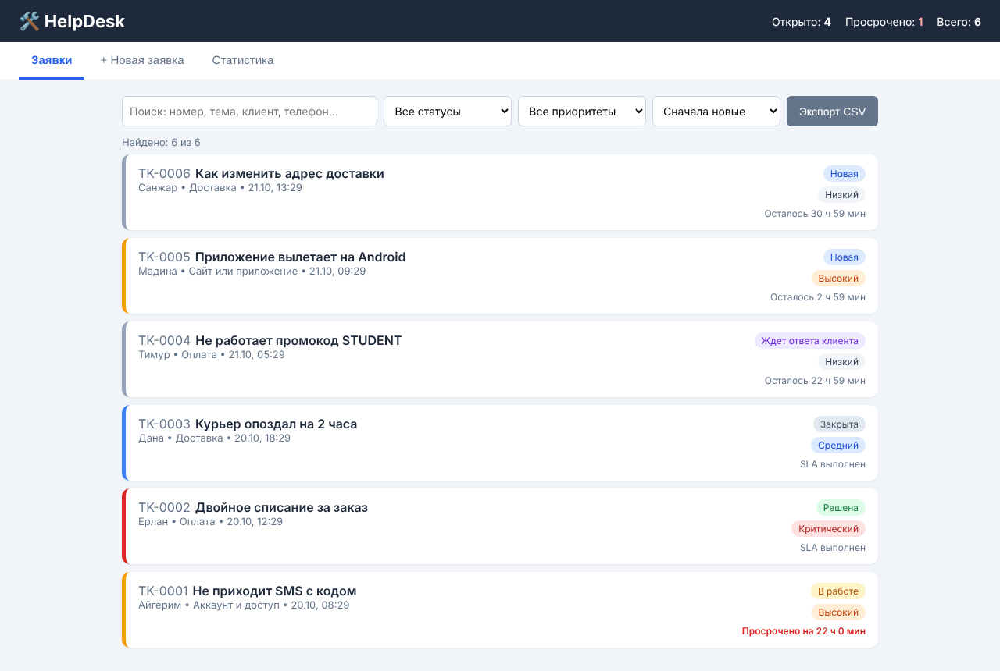
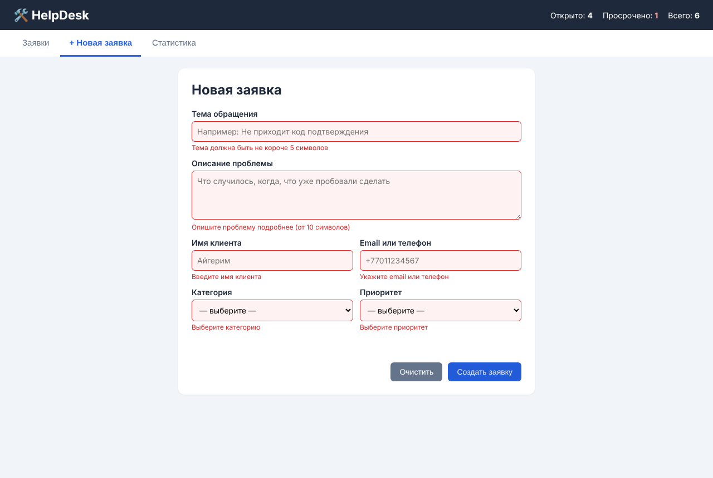
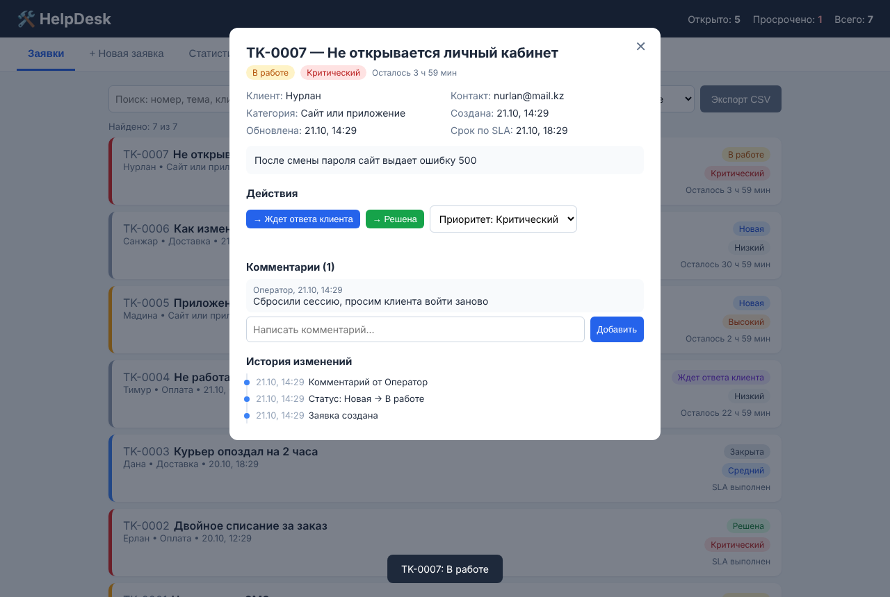
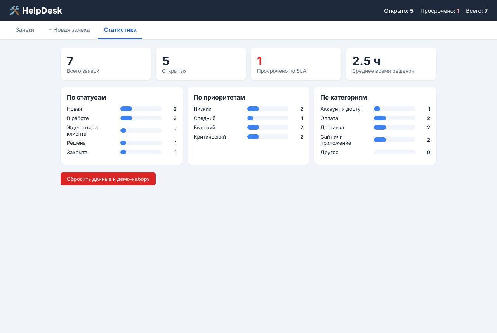

# HelpDesk — сервис заявок технической поддержки

Мини-проект СРО по дисциплине «Языки и технология программирования», тема №13.
Автор: **Нусуп Дидар Наурузбайулы**, группа ИС 26-21. Версия 1.0, октябрь 2026.



## Цель и проблема

Служба поддержки принимает обращения клиентов из разных каналов. Без единого учета заявки теряются, срочные обращения ждут вместе с простыми вопросами, а руководитель не видит просрочек и нагрузки.

**Цель** — веб-сервис учета заявок, в котором можно зарегистрировать обращение, назначить приоритет со сроком решения (SLA), провести заявку по статусам, найти ее, увидеть историю изменений и статистику.

**Целевая аудитория:** операторы первой линии поддержки и руководители смены в небольших командах (интернет-магазины, сервисы доставки, учебные и офисные IT-отделы).

## Анализ предметной области

Жизненный цикл заявки построен по практике ITIL: регистрация → классификация и приоритет → работа → решение → закрытие. Сроки SLA взяты по образцу службы поддержки University of Minnesota (P1 — 4 ч, P2 — 8 ч, P3 — 16 ч, P4 — 32 ч).

| Аналог | Плюсы | Минусы для задачи | Что взято в проект |
|---|---|---|---|
| Jira Service Management | Очереди, типы запросов, SLA-цели | Платная, сложная настройка | Категории, контроль SLA |
| Zendesk | Статусы New / Open / Pending / Solved / Closed | Платная, англоязычная | Статус «Ждет ответа клиента», переоткрытие |
| Usedesk, HelpDeskEddy | 20+ каналов, автоматизация, отчеты | Платные тарифы, интеграции | Отчеты, выгрузка CSV |
| GLPI (open source) | Матрица приоритета по ITIL | Нужны сервер и БД | Уровни приоритета, история |

Полный анализ, требования и проектирование — в [docs/Analiz_predmetnoy_oblasti_HelpDesk.docx](docs/Analiz_predmetnoy_oblasti_HelpDesk.docx).

Источники:
1. [Jira Service Management features — Atlassian](https://support.atlassian.com/jira-service-management-cloud/docs/get-to-know-the-main-jira-service-management-features/)
2. [What do the Zendesk ticket statuses mean?](https://support.openplay.net/hc/en-gb/articles/24189577184785-What-do-the-Zendesk-Ticket-statuses-mean)
3. [15 лучших helpdesk-систем 2026 — DTF](https://dtf.ru/software/5120975-luchshie-helpdesk-sistemy-dlya-podderzhki-klientov)
4. [IT Service Management — Incident Process, University of Minnesota](https://it.umn.edu/node/56176)
5. [GLPI — Matrix of calculus for priority](https://glpi-user-documentation.readthedocs.io/fr/latest/modules/assistance/prioritymatrix.html)

## Возможности

- Создание заявки: тема, описание, клиент, email или телефон, категория, приоритет; номер `TK-0001` присваивается автоматически
- Проверка ввода с сообщением рядом с полем (длина, буквы в имени, формат email и телефона `+7XXXXXXXXXX`)
- Статусы «Новая → В работе → Ждет ответа клиента → Решена → Закрыта» с контролем допустимых переходов
- Изменение приоритета, комментарии, история всех изменений с датой и временем
- Поиск по нескольким словам (номер, тема, клиент, контакт), фильтры по статусу и приоритету, 4 вида сортировки
- Контроль SLA: оставшееся время и красная отметка просроченных заявок
- Статистика: всего, открыто, просрочено, среднее время решения; распределение по статусам, приоритетам, категориям
- Экспорт отфильтрованного списка в CSV (открывается в Excel)
- Сохранение данных в браузере, адаптивная верстка для телефона

**Ограничения:** данные хранятся только в localStorage одного браузера; нет авторизации и ролей; SLA считается в календарных часах без учета графика работы.

## Стек и архитектура

HTML5, CSS3, JavaScript (ES2020) без фреймворков и библиотек. Модель жизненного цикла — инкрементная (5 приращений).

- `logic.js` — перечисления (`STATUS`, `PRIORITY`, `CATEGORIES`, `TRANSITIONS`) и чистые функции без обращения к DOM: проверка, создание, смена статуса, поиск, сортировка, SLA, статистика, CSV. Работает и в браузере, и в Node.js (для тестов).
- `app.js` — интерфейс: вкладки, отрисовка списка и карточки, обработчики событий, localStorage, демо-данные.

Схема: событие пользователя → обработчик в `app.js` → функция `logic.js` → изменение массива `tickets` → сохранение → перерисовка DOM.

```
helpdesk/
├── README.md
├── src/
│   ├── index.html
│   ├── style.css
│   ├── logic.js
│   └── app.js
├── tests/
│   ├── logic.test.js
│   └── test-cases.md
├── docs/
│   └── Analiz_predmetnoy_oblasti_HelpDesk.docx
├── screenshots/
├── presentation/
│   └── HelpDesk_Nusup_D.pptx
└── .gitignore
```

## Установка и запуск

Требования: любой современный браузер (Chrome, Edge, Firefox). Установка не нужна.

1. Скачать или клонировать репозиторий: `git clone <ссылка на репозиторий>`
2. Открыть файл `src/index.html` в браузере (двойной клик).

При первом запуске загружаются 6 демо-заявок. Вернуть демо-набор можно на вкладке «Статистика» → «Сбросить данные к демо-набору».

## Примеры использования

| Создание с проверкой ввода | Карточка заявки | Статистика |
|---|---|---|
|  |  |  |

## Тестирование

**Методика:** функции `logic.js` проверяются автотестами в Node.js (позитивные, негативные и граничные случаи); интерфейс проверен по сценариям в браузере Chromium на экранах 1280 px и 390 px, включая нагрузку 500 заявок.

Запуск автотестов (нужен Node.js 18+):

```
node tests/logic.test.js
```

Дата проверки: 21.10.2026. Окружение: Node.js 22, Chromium, Linux x64.

| ID | Сценарий | Ожидаемо | Фактически | Статус |
|---|---|---|---|---|
| T-01 | Создание корректной заявки | TK-0001, «Новая», телефон нормализован | Совпадает | PASS |
| T-03 | Все поля пустые | Заявка не создана, 6 ошибок | 6 ошибок | PASS |
| T-04 | Email `user@mail`, телефон `12345` | Ошибка поля «Контакт» | Ошибка показана | PASS |
| T-06 | Тема 4 / 5 / 100 / 101 символ | Ошибка / OK / OK / ошибка | Совпадает | PASS |
| T-08 | Новая → В работе → Решена | Статус «Решена», 3 записи истории | Совпадает | PASS |
| T-09 | Новая → Решена (запрещено) | Отказ, статус не изменился | Совпадает | PASS |
| T-13 | Поиск «ДВОЙНОЕ ерлан» | 1 заявка | 1 заявка | PASS |
| T-14 | SLA ровно 4 ч / 4 ч 1 мин | Не просрочено / просрочено | Совпадает | PASS |
| U-04 | Создание через форму | TK-0007 в начале списка | Совпадает | PASS |
| U-12 | Экспорт CSV | Заголовок + 7 строк | 8 строк | PASS |
| U-13 | Перезагрузка страницы | Данные сохранены | 7 заявок | PASS |
| U-14 | 500 заявок | Отклик ≤ 0,5 с | 52 мс | PASS |

Всего 30 тест-кейсов (16 автотестов + 14 проверок интерфейса), все PASS. Полный протокол — [tests/test-cases.md](tests/test-cases.md).

## Дефекты и ограничения

- Исправлено: в истории выводилось «Комментарий от Оператор» (неверный падеж) → «Добавлен комментарий (Оператор)».
- Ограничения: см. раздел «Возможности». Планы развития: серверная часть и общая база, роли операторов, прием заявок из Telegram и почты, учет рабочего графика в SLA, база знаний.

## Автор

Нусуп Дидар Наурузбайулы (ИС 26-21) — анализ, требования, проектирование, разработка, тестирование, документация.
Презентация: [presentation/HelpDesk_Nusup_D.pptx](presentation/HelpDesk_Nusup_D.pptx)

Демо-данные в проекте вымышленные, персональных данных и паролей в репозитории нет.
